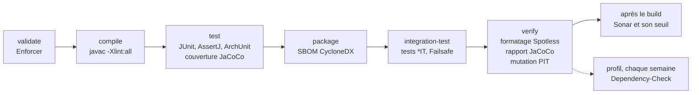

# Chaîne complète

Tous les contrôles qualité réunis dans un **POM parent**, appliqués à un petit projet métier.

Le parent ([pom.xml](pom.xml)) configure chaque outil une seule fois. Le projet [calendrier/](calendrier/pom.xml) le
déclare comme parent et ne déclare ni plugin ni version : il hérite de tout. Il reste **indépendant** : Maven trouve le
parent par son chemin relatif, sans l'installer, et le projet se construit seul. Un autre projet, dans ce dépôt ou
ailleurs, profiterait des mêmes contrôles en déclarant le même parent. Un projet multi-modules n'en est qu'un cas
particulier : son POM racine déclare ce parent.

## Ce que ce dossier montre, et que les autres ne montrent pas

Chaque autre dossier montre un outil seul. Ici, ils fonctionnent ensemble :

- **ils interagissent** : JaCoCo instrumente les tests, Sonar lit son rapport ; PIT relance les tests en désactivant
  JaCoCo ;
- **ils ne coûtent pas le même temps** : tout ce qui est rapide tourne à chaque build, PIT compris ; Dependency-Check,
  lent, est dans un profil lancé chaque semaine ;
- **ils s'adaptent au projet** : un projet règle ou désactive un contrôle par une propriété, sans toucher au parent ;
- **ils s'adaptent au contexte** : chaque outil est un choix par défaut, à confronter à l'existant.

## Lancer

```bash
./mvnw -f controles/chaine-complete/calendrier verify               # tous les contrôles du build
./mvnw -f controles/chaine-complete/calendrier verify -Psecurite    # en plus : failles des dépendances
```

Sous Windows : `.\mvnw.cmd` au lieu de `./mvnw`. `-Psecurite` demande une clé gratuite de la NVD dans la variable
d'environnement `NVD_API_KEY`.

## Où chaque contrôle intervient

Chaque outil est attaché à une phase du cycle de vie Maven : `verify` les déclenche tous, dans cet ordre.



## Les contrôles

| Contrôle | Outil | Le build échoue si… | Rapport |
|---|---|---|---|
| Environnement | Maven Enforcer | Java < 25, Maven < 3.9 | console |
| Dépendances interdites | Maven Enforcer | Log4j 1, Commons Logging ou JUnit 4 présent, même par transitivité ; une dépendance déclarée deux fois | console |
| Formatage | Spotless, google-java-format AOSP | un fichier n'est pas formaté ; `spotless:apply` corrige | console |
| Tests unitaires | JUnit 6, AssertJ, Surefire | un test `*Test` échoue | `calendrier/target/surefire-reports/` |
| Tests d'intégration | Failsafe | un test `*IT` échoue ; le calendrier n'en a pas (voir plus bas) | `calendrier/target/failsafe-reports/` |
| Architecture | ArchUnit | une règle de `ArchitectureTest` est enfreinte : sens des dépendances entre paquets, pas de `System.out`, pas d'exception générique, pas de `java.util.logging`, pas d'injection par champ | message du test |
| Couverture | JaCoCo | — mesurée ici, jugée par Sonar | `calendrier/target/site/jacoco/index.html` |
| Inventaire des composants | CycloneDX | — produit à chaque build | `calendrier/target/bom.json`, `calendrier/target/bom.xml` |
| Qualité et sécurité du code | SonarQube Cloud, « Sonar way » | le seuil n'est pas atteint sur le nouveau code : nouveau problème, couverture < 80 %, duplication, point sensible non revu | SonarQube Cloud |
| Qualité des tests | PIT | moins de 80 % des mutants détectés | `calendrier/target/pit-reports/index.html` |
| Failles des dépendances (`-Psecurite`) | OWASP Dependency-Check | une faille de gravité 7 ou plus (CVSS) | `calendrier/target/dependency-check-report.html` |

Le calendrier n'a pas de test d'intégration : il ne dépend d'aucune ressource extérieure (fichier, base, service), et
tous ses tests sont unitaires, même ceux qui parcourent des siècles. Failsafe reste configuré dans le parent pour les
projets qui en ont : une classe suffixée `IT` y est lancée après l'empaquetage, et son échec fait échouer `verify`.

PIT relance les tests pour chaque mutant : ici, quelques secondes, il reste donc dans le build et bloque dès le poste du
développeur. Sur un gros projet, il prendrait des dizaines de minutes : on le limite alors aux classes modifiées par la
pull request, et l'analyse complète passe dans un profil planifié.

Dependency-Check est dans un profil : la mise à jour de sa base de failles est lente et demande une clé. Son intérêt
au-delà du build : découvrir les failles publiées **depuis** le dernier commit, sur le code pas encore livré. La CI le
lance chaque lundi (`weekly.yml`). Les versions livrées, elles, sont surveillées par Dependency-Track à partir de leur
SBOM, et GitHub signale de son côté les dépendances vulnérables (alertes Dependabot).

## Régler un contrôle, projet par projet

Chaque seuil est une propriété du parent ; un projet la redéfinit dans ses `<properties>` :

| Propriété | Rôle | Valeur |
|---|---|---|
| `java.version` | version de Java du projet | 25 |
| `pitest.mutationThreshold` | part minimale de mutants détectés | 80 |
| `dependency-check.failBuildOnCVSS` | gravité à partir de laquelle une faille fait échouer | 7 |

Un contrôle se désactive de la même façon, par une propriété standard du plugin : `spotless.check.skip`,
`enforcer.skip`, `skipITs`, `jacoco.skip`, `cyclonedx.skip`. C'est exceptionnel, temporaire et justifié.

Un faux positif de Dependency-Check se déclare dans le fichier du projet,
[calendrier/dependency-check-suppressions.xml](calendrier/dependency-check-suppressions.xml), avec sa raison et une date
de révision.

## Adapter au contexte

Chaque outil est ici un choix par défaut, pas une exigence. Dans une organisation existante, on part de ce qui est en
place, et on ne remplace un outil qu'avec l'accord de ceux qui l'exploitent.

| Ici | Souvent en place ailleurs | À vérifier avant de proposer |
|---|---|---|
| google-java-format | formateur Eclipse partagé | ne pas reformater tout le code sans accord, et alors en un seul commit, ignoré par `git blame` |
| SonarQube Cloud, « Sonar way » | SonarQube Server, profil et seuil maison | règles et seuil imposés, version du serveur, accès depuis la CI |
| Dependency-Check, pendant le build | Snyk, Sonatype Nexus IQ, JFrog Xray | outil déjà en place ou sous licence ; accès à la base NVD depuis le réseau, sinon miroir interne |
| SBOM CycloneDX, conservé par la CI | Dependency-Track qui surveille les versions livrées ; format SPDX exigé | où déposer le SBOM, dans quel format |
| POM parent du projet | POM parent d'entreprise | le parent du projet hérite de celui de l'entreprise et peut durcir ses règles, jamais les assouplir ni les contourner |
| Java 25 | version imposée par la production | Enforcer aligné sur la cible réelle |
| Maven Wrapper | Maven fourni par l'usine de build | qui choisit la version de Maven |

## Le projet métier

Un calendrier des jours fériés français, avec la variante d'Alsace-Moselle, et le décompte des délais en jours
calendaires, ouvrables ou ouvrés : « J+3 ouvrés », nombre de jours ouvrables d'un mois. Un férié n'étant pas toujours
chômé, un calendrier peut en travailler certains, comme le lundi de Pentecôte.

```java
// Construit une fois, au démarrage : un territoire et les choix de l'entreprise
Calendrier calendrier = Calendrier.de(Territoire.METROPOLE).enTravaillant(Ferie.LUNDI_DE_PENTECOTE);

calendrier.avancer(dateDeReception, 3, TypeDeJour.OUVRE);         // date limite d'une demande
calendrier.entre(debutConges, finConges, TypeDeJour.OUVRABLE);    // jours de congés décomptés
calendrier.estUnJour(TypeDeJour.OUVRE, aujourdhui);               // lancer ou non un traitement
calendrier.feriesDe(2026);                                         // fériés de l'année, par date
```

| Type | Rôle |
|---|---|
| `Ferie` | les treize fériés et leur règle : date fixe, ou écart avec Pâques |
| `Territoire` | les fériés qui s'appliquent : métropole ou Alsace-Moselle |
| `TypeDeJour` | les jours qui comptent dans un délai : calendaires, ouvrables ou ouvrés |
| `Calendrier` | les questions qu'on lui pose : fériés d'une année (depuis 1982), jour qui compte ou non, J+n, nombre de jours entre deux dates |

Les tests énoncent chacun une règle vérifiable (`leJourDeDepartNeComptePas`, `unSamediFerieNeComptePas`) ;
`ArchitectureTest` vérifie que les énumérations ne dépendent pas du calendrier qui les utilise. Les limites sont
testées des deux côtés (1981 refusée, 1982 acceptée ; J+0, J+1), ce qui permet à PIT de détecter les mutants.

En production, on évaluerait d'abord une bibliothèque existante, comme Jollyday : ce calendrier est un support de
démonstration.
